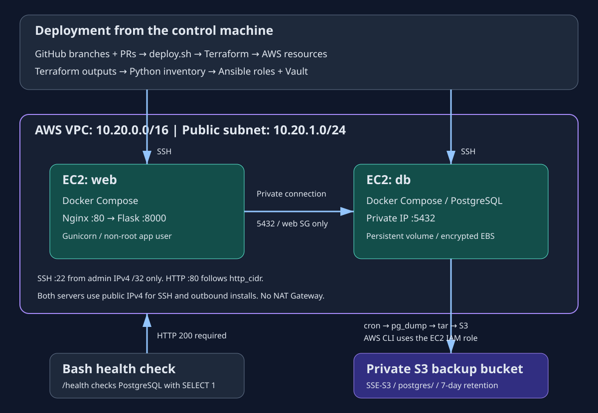

# Automated Deployment of a Containerized App on AWS

مشروع تدريبي يجمع Linux وBash وPython وGit/GitHub وDocker وAnsible وTerraform وAWS، بدون CI/CD.

## المعمارية

- Terraform ينشئ VPC وشبكة فرعية عامة ومسارات الإنترنت.
- خادمان Ubuntu 24.04: web وdb، مع Security Groups منفصلة.
- web يشغّل Nginx وFlask/Gunicorn باستخدام Docker Compose.
- db يشغّل Postgres مع volume لحفظ البيانات.
- Flask يتصل بقاعدة البيانات عبر عنوانها الخاص.
- Python يولّد Ansible inventory من Terraform outputs.
- Ansible يجهّز الخوادم باستخدام Roles وVault.
- cron ينفذ pg_dump ويرفع نسخة مضغوطة إلى S3 باستخدام IAM role.

## المتطلبات

- Linux أو Ubuntu داخل WSL.
- Python 3.14 وvenv.
- Git وBash وcurl وOpenSSH وflock.
- Terraform >=1.6 و<2.
- AWS CLI v2 وجلسة حساب صالحة.
- صلاحيات إنشاء وإدارة موارد EC2 وVPC وS3 وIAM وPassRole وقراءة SSM.
- Docker محلي اختياري للاختبارات؛ صورة التطبيق تُبنى على web أثناء النشر.

## التكلفة

اختيار t3.micro لا يضمن المجانية؛ راجع أهلية حسابك والمنطقة في AWS Billing وFree Tier.
المشروع يستخدم خادمين وعنواني public IPv4 وقرصين بإجمالي 16 GiB، إضافة إلى S3 ونقل البيانات.
لا يستخدم NAT Gateway أو Load Balancer.
احذف الموارد بعد كل جلسة.

## ملفات المشروع

| المسار | الوظيفة |
|---|---|
| terraform/ | موارد AWS والمتغيرات والمخرجات |
| ansible/roles/ | إعداد Linux وDocker والتطبيق والنسخ |
| app/ | تطبيق Flask وDockerfile |
| scripts/gen_inventory.py | تحويل outputs إلى inventory |
| setup.sh | تجهيز الإعدادات المحلية |
| deploy.sh | النشر وفحص الصحة |
| destroy.sh | حذف الموارد |
| scripts/check_idempotence.sh | اختبار التشغيل الثاني |
| .local/ | ملفات محلية خاصة مستثناة من Git |

## التجهيز

افتح Terminal داخل مجلد المستودع، ثم نفذ:

    python3 -m venv .venv
    source .venv/bin/activate
    python -m pip install -r requirements.txt
    ./setup.sh

setup.sh ينشئ الملفات الناقصة ويحافظ على الموجودة:
مفتاح SSH، وكلمة فك Vault، وملف كلمة DB المشفر، وterraform.tfvars.

تحقق من جلسة AWS:

    aws sts get-caller-identity

اعرض أسماء profiles المتوفرة:

    aws configure list-profiles

فعّل الاسم الحقيقي الذي تستخدمه. المثال التالي يطابق جهاز تنفيذ المشروع؛ غيّره إذا كان اسمك مختلفًا:

    export AWS_PROFILE=my-project

عدّل terraform/terraform.tfvars:

- aws_region: المنطقة المطلوبة.
- project: اسم المشروع.
- admin_cidr: عنوان جهازك العام مع /32.
- http_cidr: النطاق المسموح له بفتح HTTP.
- instance_type: t3.micro أو t2.micro حسب الإتاحة والأهلية.

إذا تغيّر عنوان الإنترنت أو VPN، حدّث admin_cidr.

## النشر بأمر واحد

    ./deploy.sh

السكريبت يفحص المتطلبات والمصادقة، ثم ينفذ Terraform init وvalidate وplan وapply.
بعدها يولّد inventory، ويشغّل Ansible، وينتظر نجاح /health.

تطبيق الخطة لا يطلب تأكيدًا إضافيًا.
إذا فشل النشر، فقد تبقى موارد موجودة؛ أصلح الخطأ وأعد المحاولة أو استخدم destroy.sh.

## فحص التطبيق

    URL=$(terraform -chdir=terraform output -raw app_url)
    ./scripts/health_check.sh "$URL"
    curl -i "$URL/health"

المسار /health ينفذ SELECT 1 على Postgres.
HTTP 200 يعني نجاح الاتصال والاستعلام، و503 يعني عدم جاهزية الاتصال.
نجاح الصفحة الرئيسية وحده لا يثبت اتصال DB.

## اختبار idempotence

بعد نجاح النشر، نفذ مباشرة:

    ./scripts/check_idempotence.sh

المطلوب لكلا الخادمين: changed=0 وunreachable=0 وfailed=0.
السجل محفوظ في .local/idempotence.log.
الاختبار يعيد التشغيل فعليًا، ولا يستخدم --check.
تعديل الملفات أو تدخل خارجي أو انتهاء صلاحية apt cache قد يؤدي إلى changed حقيقي.

## النسخ الاحتياطي

السكريبت على db هو /usr/local/sbin/backup-postgres.sh.
ينفذ pg_dump بصيغة custom، ويضيف SHA256SUMS، ثم ينشئ tar.gz ويرفعه إلى postgres/ داخل S3.
تُنظف الملفات المؤقتة حتى عند الفشل.
الرفع يستخدم IAM role ولا يحتاج access keys على الخادم.

cron يعمل الساعة 02:00 بتوقيت الخادم؛ عند استخدام UTC تكون 05:00 بتوقيت بغداد.
تحقق من توقيت الخادم بعد النشر.
نسخ S3 تصبح مؤهلة للحذف بعد 7 أيام؛ التنفيذ ليس فوريًا.

لتشغيل نسخة يدوية:

    DB=$(terraform -chdir=terraform output -raw db_public_ip)
    ssh -i .local/id_ed25519 -o UserKnownHostsFile=.local/known_hosts "ubuntu@$DB" 'sudo /usr/local/sbin/backup-postgres.sh'

لفحص النسخ بهوية مشغّل لديها صلاحية العرض:

    BUCKET=$(terraform -chdir=terraform output -raw backup_bucket)
    REGION=$(terraform -chdir=terraform output -raw aws_region)
    aws s3 ls "s3://$BUCKET/postgres/" --region "$REGION"

pg_dump ينسخ قاعدة التطبيق، ولا يشمل PostgreSQL global roles.
يجب اختبار الاستعادة، وليس الاكتفاء بوجود ملف في S3.

## الأسرار وحدود المختبر

- كلمة DB في Vault؛ كلمة فك Vault ومفتاح SSH الخاص يبقيان على جهازك.
- لا توجد access keys فعلية في الكود أو على الخوادم.
- state وtfvars وinventory وملفات .local وVault مستثناة من Git.
- ملفات الأسرار على الخوادم مقيدة الصلاحيات، لكن root يستطيع قراءتها.
- Compose secrets هنا ملفات مركبة داخل الحاويات.
- مفتاح SSH بدون passphrase لأتمتة المختبر؛ يجب حمايته.
- مفتاح المضيف يُقبل في الاتصال الأول، ويُرفض تغيّره لاحقًا.
- DB تسمح بالمنفذ 5432 من web Security Group فقط.
- تغيير كلمة Vault وحده لا يغيّر كلمة Postgres داخل volume موجود.
- الـvolume لا يحمي من حذف خادم EC2 وقرصه.
- التصميم يستخدم public subnet للخادمين لتبسيط المختبر، وليس للإنتاج.
- AMI لا تُحدّث تلقائيًا للخادم الموجود.
- state محلي؛ لا تدِر النشر من أجهزة متعددة دون إعداد backend مناسب.

## الحذف

    ./destroy.sh
    terraform -chdir=terraform state list

بعد الحذف يجب أن تكون قائمة state فارغة.
تحقق من AWS Console بالحساب والمنطقة الصحيحين.

الحذف يشمل أقراص EC2 وS3 bucket وجميع نسخه الاحتياطية.
نزّل ما تريد الاحتفاظ به أولًا.
لا تحذف state أو تغيّر الحساب والمنطقة قبل التنظيف.
السكريبت لا يحذف موارد أُنشئت خارج المشروع.

## التحقق المنفذ حتى الآن

- Terraform validate وخطة 17 إضافة دون تنفيذ.
- Ansible syntax check وفحص قوالب Compose.
- توليد inventory والتحقق من مجموعاته وصلاحية 0600.
- بناء وتشغيل Flask محليًا بمستخدم غير root.
- استجابة / بالرمز 200 و/health بالرمز 503 دون DB.
- فحص Bash وتشغيل setup.sh بنجاح.

نتائج التنفيذ على AWS — 2026-11-10:

- نجح النشر باستخدام ./deploy.sh.
- نجح فحص /health بالرمز HTTP 200.
- نجح التشغيل الثاني: changed=0 وunreachable=0 وfailed=0 للخادمين.
- نجح تشغيل النسخ الاحتياطي يدويًا ورفع الأرشيف إلى S3.
- نجح تنزيل النسخة والتحقق من SHA256: database.dump: OK.
- استجابت قاعدة اختبار Postgres المحلية لاستعلام SELECT 1.
- خدمة cron كانت active، والخادم بتوقيت Etc/UTC، والمهمة مضبوطة على 02:00 يوميًا.
- لم ننتظر موعد cron؛ اختبار النسخ الفعلي نُفّذ يدويًا.
- نجح ./destroy.sh بحذف 17 موردًا، وأصبحت قائمة Terraform state فارغة.

استُبدل تثبيت awscli عبر APT بمُثبّت AWS CLI v2 الرسمي، مع تجاوز التثبيت عند وجوده.
رابط التطبيق مؤقت ويتوقف بعد حذف الموارد.

## GitHub workflow

- main: الفرع الأساسي.
- feature/terraform: البنية الأساسية — PR 1.
- feature/ansible-compose: التطبيق وAnsible — PR 2.
- feature/deploy-scripts: سكريبتات التشغيل والتوثيق وإصلاح تثبيت AWS CLI — PR 3.

لا توجد CI/CD workflows.
